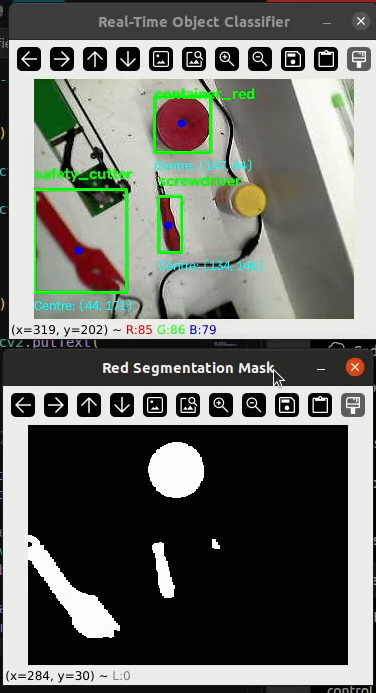
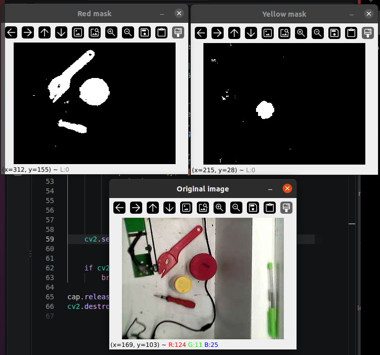
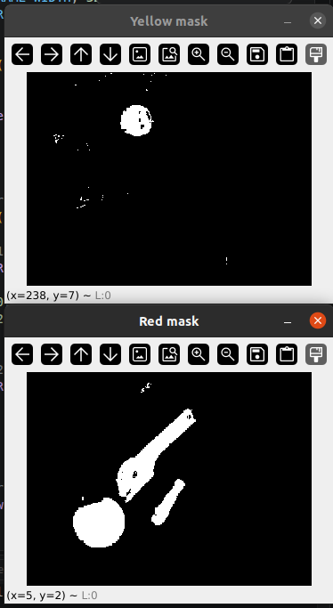

# Classical Vision Robotic Arm

**A classical computer vision project for real-time object detection, feature extraction, and object classification — laying the groundwork for vision-guided robotic manipulation.**

<p align="center">
  
</p>

<p align="center">
  
  
  
  
  
</p>

## Overview

This project explores how conventional computer vision and lightweight machine learning can be used to detect and classify objects in a live camera feed.

The system uses colour segmentation to isolate red objects, extracts geometric and shape-based features from detected contours, and applies a trained Decision Tree classifier to distinguish between selected object categories.

The longer-term objective is to connect visual perception with a physical robotic arm, enabling detected objects to be located in the camera frame and eventually mapped to robot coordinates for manipulation.

The current implementation focuses on the **perception and classification stage**. Camera-to-robot calibration, inverse kinematics, and physical pick-and-place integration remain future development tasks.

## Project Goals

- Develop a real-time classical computer vision pipeline using OpenCV.
- Detect objects using HSV colour segmentation and contour analysis.
- Extract interpretable geometric features from detected objects.
- Train a lightweight machine learning classifier using labelled examples.
- Display predicted object classes and bounding boxes in a live camera feed.
- Establish a foundation for future vision-guided robotic manipulation.

## System Pipeline

```text
Camera Input
     |
     v
Frame Acquisition
     |
     v
HSV Colour Conversion
     |
     v
Red Colour Segmentation
     |
     v
Binary Mask and Morphological Filtering
     |
     v
Contour Detection
     |
     v
Geometric Feature Extraction
     |
     v
Trained Decision Tree Classifier
     |
     v
Predicted Class + Bounding Box + Centroid
     |
     v
Future Work: Camera-to-Robot Coordinate Mapping
     |
     v
Future Work: Inverse Kinematics and Robot Control
```

## Demonstrations

### 1. Colour segmentation

HSV thresholding isolates red regions from the camera image. Separate hue ranges are used to account for red appearing near both ends of the HSV hue scale.



### 2. Binary masks and contour detection

The segmented image is converted into a binary mask. Contours are extracted and filtered by area to reduce detections caused by small regions of noise.



### 3. Real-time object classification

The trained classifier predicts the class of each detected red object using extracted shape and geometry features. The live display shows the predicted label and detected object's bounding box.


> **Note:** If a screenshot does not appear, check that its filename and capitalisation match the actual file in the `images/` directory. GitHub paths are case-sensitive.

## Object Classes

The current labelled dataset contains three classes:

| Class label | Description |
|---|---|
| `container_red` | Red container |
| `safety_cutter` | Safety cutter |
| `screwdriver` | Screwdriver |

The classifier uses shape and geometric measurements rather than a deep neural network.

## Technology Stack

| Technology | Purpose |
|---|---|
| Python | Main programming language |
| OpenCV | Camera input, image processing, segmentation, and contour detection |
| NumPy | Numerical operations and image-array processing |
| pandas | Dataset loading and manipulation |
| scikit-learn | Decision Tree training and evaluation |
| joblib | Saving and loading the trained model |

The current approach deliberately uses **classical computer vision and conventional machine learning**, rather than deep learning, to keep the pipeline lightweight and its intermediate processing steps interpretable.

## Feature Engineering

For each detected contour, the system extracts the following features:

| Feature | Description |
|---|---|
| `area` | Contour area in pixels |
| `width` | Bounding-box width |
| `height` | Bounding-box height |
| `aspect_ratio` | Width divided by height |
| `perimeter` | Contour perimeter |
| `circularity` | Shape measure based on area and perimeter |
| `solidity` | Contour area relative to its convex hull |
| `extent` | Contour area relative to its bounding-box area |

These features provide a compact numerical representation of each object. The trained Decision Tree learns patterns in these measurements to distinguish between the labelled classes.

Because the features depend on the camera view, object orientation, lighting, and segmentation quality, classification performance can vary when these conditions change.

## Dataset and Model Training

The dataset is stored in `red_objects.csv`. Each labelled observation contains geometric features extracted from a detected object and its corresponding class label.

The training script:

1. Loads the labelled dataset.
2. Selects the eight engineered features.
3. Removes rows with missing feature or label values.
4. Splits the data into training and test subsets using a stratified split.
5. Trains a Decision Tree classifier with a maximum depth of four.
6. Evaluates predictions using accuracy, a classification report, and a confusion matrix.
7. Saves the trained model and feature list to `red_object_classifier.joblib`.

The saved model is loaded by the live classification script, avoiding the need to retrain the classifier every time the camera application starts.

### Reported evaluation

An earlier evaluation produced the following confusion matrix:

```text
[[14  0  0]
 [ 0 15  0]
 [ 0  0 17]]
```

For that evaluation split, all 46 test samples were classified correctly.

**Important:** This result represents one evaluation on the collected dataset. It does not establish generalisation to unseen environments, different cameras, changing lighting, or new object instances. More varied data and repeated evaluation are needed for a robust performance estimate.

## Repository Structure

```text
classical-vision-robotic-arm/
├── images/
│   ├── color_segmentation.png
│   ├── binary_masks.png
│   ├── realtime_detection.png
│   └── ...
├── notebooks/
│   └── camera_test.ipynb
├── src/
│   ├── color_segmentation.py
│   ├── collect_training_data.py
│   ├── geometry_features.py
│   ├── train_classifier.py
│   ├── realtime_classifier_live.py
│   └── test.py
├── red_objects.csv
├── red_object_classifier.joblib
├── requirements.txt
├── .gitignore
└── README.md
```

`collect_training_data.py` and `geometry_features.py` currently serve overlapping data-collection purposes. `test.py` and `realtime_classifier_live.py` also contain overlapping live-inference functionality; these can be consolidated as the project matures.

## Getting Started

### Prerequisites

- Python 3
- A compatible webcam
- Git
- A working Python environment with camera access

### 1. Clone the repository

```bash
git clone https://github.com/ABIMGOOD/classical-vision-robotic-arm.git
cd classical-vision-robotic-arm
```

### 2. Create a virtual environment

```bash
python3 -m venv .venv
source .venv/bin/activate
```

If virtual-environment support is missing on Ubuntu, install it with:

```bash
sudo apt update
sudo apt install python3-venv
```

### 3. Install dependencies

```bash
pip install -r requirements.txt
```

### 4. Test the camera

Open the camera notebook in Jupyter, or run an appropriate camera test script from the `src/` directory.

For example:

```bash
python3 src/color_segmentation.py
```

The current scripts use camera index `1` in their camera configuration. If your webcam is assigned a different index, update the relevant script accordingly.

### 5. Train the classifier

```bash
python3 src/train_classifier.py
```

The training script should read `red_objects.csv` from the project root and save the resulting model to `red_object_classifier.joblib` in the project root.

If your current script uses an absolute path to a local CSV file, change it to a project-relative path before running it:

```python
pd.read_csv("red_objects.csv")
```

### 6. Run real-time classification

```bash
python3 src/realtime_classifier_live.py
```

Ensure the saved model is available at the path expected by the script and that the correct webcam is selected.

**Troubleshooting:** If the script reports that the CSV or model cannot be found, check the paths in the script. This README assumes the dataset and model remain in the repository root.

## Current Limitations

- **Colour dependence:** the current detection pipeline focuses on red objects.
- **Contour merging:** touching or overlapping objects may be detected as a single contour.
- **Viewpoint sensitivity:** rotation, perspective, and occlusion can change extracted geometric features.
- **Lighting sensitivity:** illumination and reflections can affect HSV segmentation.
- **Dataset coverage:** the classifier is trained on a limited, manually collected dataset.
- **Camera calibration:** image coordinates are not yet calibrated to physical table coordinates.
- **Robot integration:** the current pipeline does not yet execute autonomous pick-and-place actions.

These limitations define the next engineering steps rather than being claims of completed functionality.

## Roadmap

- [x] Live camera acquisition with OpenCV
- [x] HSV-based red object segmentation
- [x] Contour detection and geometric feature extraction
- [x] Labelled training-data collection
- [x] Decision Tree training and evaluation
- [x] Saved-model inference in a live camera feed
- [ ] Consolidate duplicate scripts and standardise file paths
- [ ] Expand the dataset across object instances, orientations, and lighting conditions
- [ ] Evaluate generalisation using more robust validation
- [ ] Improve handling of overlapping objects
- [ ] Calibrate the camera for table-plane coordinate estimation
- [ ] Map image coordinates to robot workspace coordinates
- [ ] Implement inverse kinematics and Arduino communication
- [ ] Test controlled pick-and-place behaviour on the physical robotic arm

## Future Direction: Vision-Guided Manipulation

The intended next stage is to transform the detected object centroid from image pixels into a coordinate on the robot's workspace.

That process will require camera calibration and a suitable coordinate transformation. The resulting target position can then be used by a robot-control pipeline that accounts for the arm's geometry, reachable workspace, and inverse kinematics.

The current classifier is a perception prototype and does not yet perform these operations. The aim is to develop the project incrementally, validating each stage before integrating it with physical hardware.

## Author

**Goodness Abimbola**

Mechatronics Engineering | Robotics | Computer Vision | Control Systems

- GitHub: [@ABIMGOOD](https://github.com/ABIMGOOD)
- Project repository: [classical-vision-robotic-arm](https://github.com/ABIMGOOD/classical-vision-robotic-arm)

## License

See the repository's `LICENSE` file for licensing terms.
