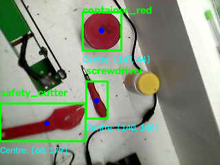

cat > README.md <<'EOF'
# Classical Vision Robotic Arm

**Classical computer vision for red-object detection and shape-based classification, as the first stage of a future robotic-arm sorting system.**

> **Status: In development.** The current prototype performs webcam-based colour segmentation, geometric feature extraction, Decision Tree classification, and image-pixel centre localisation. Arduino integration, camera calibration, inverse kinematics, and automated pick-and-place remain future work.

## Sample Results

### 1. HSV Colour Segmentation


Red objects are segmented using HSV thresholding. Two hue intervals are combined because red wraps around the hue boundary in OpenCV's HSV colour representation. A separate yellow mask is also explored.

### 2. Real-Time Object Classification


The live pipeline detects red contours, extracts shape features, predicts an object class, and displays the detected centre in image pixels.

### 3. Classifier Demonstration



These images show the current development prototype. Results may vary with lighting, background, object orientation, and whether objects touch or overlap.

## Project Overview

This project investigates a lightweight, interpretable approach to object recognition without deep learning. It currently distinguishes three red objects with similar colours but different shapes:

- `container_red` — red container
- `screwdriver` — screwdriver with a red handle
- `safety_cutter` — red safety cutter

Colour segmentation identifies candidate regions. Contours describe their shapes, and a supervised Decision Tree classifier uses geometric measurements to predict the object class.

The longer-term goal is to connect vision with a small robotic arm for object sorting. The planned next stages are servo-control testing, image-to-table calibration, inverse kinematics, and an integrated pick-and-place demonstration.

## System Architecture

```text
USB Webcam
    |
    v
BGR Image -> HSV Colour Conversion
    |
    v
Red Thresholding (two hue ranges)
    |
    v
Morphological Opening and Closing
    |
    v
Contour Detection and Small-Contour Filtering
    |
    v
Geometric Feature Extraction
    |
    v
Trained Decision Tree Classifier
    |
    v
Predicted Label + Centre (cx, cy) in Image Pixels

Important: (cx, cy) represents pixel coordinates in the camera image, not physical coordinates on the table. A calibration transform is required before these coordinates can be used to position a robot arm.

## Technology Stack

Technology	Purpose
Python	Main programming language
OpenCV	Webcam access, HSV conversion, thresholding, morphology, contour detection and visualisation
NumPy	Image arrays and numerical feature inputs
pandas	Loading and preparing the labelled dataset
scikit-learn	Train/test split, Decision Tree classifier and model evaluation
joblib	Saving and loading the trained model
CSV	Storing labelled geometric features
USB webcam	Image acquisition
Ubuntu Linux	Development environment

## Geometric Features
The classifier uses eight features calculated from each contour:
Feature	Description
area	Contour area in pixel-squared units
width	Width of the bounding rectangle, in pixels
height	Height of the bounding rectangle, in pixels
aspect_ratio	Bounding-rectangle width divided by height
perimeter	Contour perimeter, in pixels
circularity	4π × area / perimeter², a measure related to shape roundness
solidity	Contour area divided by convex-hull area
extent	Contour area divided by bounding-rectangle area
These measurements describe object geometry rather than relying on colour alone. They can change with viewpoint, scale, image resolution, segmentation quality, and partial occlusion.
Repository Contents
File	Purpose
color_segmentation.py	Interactive red/yellow HSV segmentation and basic contour measurements
collect_training_data.py	Collects labelled geometric-feature examples
geometry_features.py	Earlier version of the feature-extraction and data-collection script
train_classifier.py	Trains and evaluates the Decision Tree and saves the model
realtime_classifier_live.py	Live classification using the saved model
test.py	Original development version of the live classifier
red_objects.csv	Labelled feature dataset
red_object_classifier.joblib	Saved model and expected feature order
camera_test.ipynb	Webcam experimentation notebook
images/	Project screenshots
requirements.txt	Python dependencies
.gitignore	Excludes common generated and local files
LICENSE	MIT licence
Some scripts overlap because the project is still being organised. They are retained while the code structure is refined.
Installation
Requirements
- Python 3.8 or later is recommended, subject to dependency compatibility.
- A webcam accessible to OpenCV.
- The repository and its dataset.
Clone the repository:
git clone https://github.com/ABIMGOOD/classical-vision-robotic-arm.git
cd classical-vision-robotic-arm


Create and activate a virtual environment:
python3 -m venv .venv
source .venv/bin/activate


Install the packages:
python -m pip install --upgrade pip
pip install -r requirements.txt


On Ubuntu, if virtual-environment support is missing, install the appropriate python3-venv system package and retry.
Running the Project
Run commands from the repository root so relative paths resolve correctly.
1. Colour segmentation
python color_segmentation.py


Displays the camera image and red/yellow masks. Clicking the original-image window prints the selected pixel's HSV values. Press q to quit.
2. Collect labelled examples
python collect_training_data.py


Place one clearly separated red object in view and press:
- 1 — red container
- 2 — screwdriver
- 3 — safety cutter
- q — quit
The script records features from the largest eligible red contour and appends them to red_objects.csv. Ensure the intended object is the largest red region and is not touching another object. Inspect the CSV before retraining.
3. Train and evaluate
python train_classifier.py


The script loads red_objects.csv, prepares the eight features, and creates a stratified 75/25 train/test split using random_state=42. It trains a DecisionTreeClassifier with max_depth=4, prints accuracy, a classification report and a confusion matrix, then saves red_object_classifier.joblib.
4. Live classification
python realtime_classifier_live.py


Loads the saved model, segments red regions, extracts contour features, predicts labels, and draws bounding boxes and image-pixel centres. Press q to quit.
Camera selection
The current scripts use camera index 1. If the wrong camera opens or no camera is found, change cv2.VideoCapture(1) or CAMERA_INDEX = 1 to 0 or another valid index for your system.
Initial Model Evaluation
An earlier development run produced this confusion matrix:
[[14  0  0]
 [ 0 15  0]
 [ 0  0 17]]


The class order was container_red, safety_cutter, screwdriver. This corresponds to 46 correct predictions out of 46 test examples (100% on that split).
This is an initial result, not proof of real-world generalisation. Samples captured under similar conditions can make a random split easier than testing on genuinely new scenes. More reliable evaluation should use separate capture sessions and varied lighting, backgrounds, positions, and orientations. Run the training script to calculate metrics for the dataset currently in the repository.
Known Limitations
- Touching objects: external contours may merge multiple objects into one shape, leading to incorrect predictions.
- Lighting: HSV thresholds may need tuning for different illumination and camera exposure.
- Colour dependence: the trained classifier currently targets red objects. The yellow mask is an experiment, not a trained yellow-object classifier.
- Largest-contour collection: only the largest eligible red contour is labelled by the data-collection script.
- Viewpoint and scale: geometric measurements change with object orientation, distance, and image resolution.
- Pixel coordinates: image centres have not yet been calibrated to physical table coordinates.
- Robot integration: servo control, inverse kinematics, and an integrated pick-and-place cycle are not yet implemented.
Roadmap
- [x] Capture webcam frames with OpenCV.
- [x] Segment red regions in HSV colour space.
- [x] Extract geometric contour features.
- [x] Collect labelled examples in CSV format.
- [x] Train and save a Decision Tree classifier.
- [x] Display live predictions and pixel centres.
- [ ] Improve dataset diversity and evaluate on separate capture sessions.
- [ ] Improve segmentation of touching and overlapping objects.
- [ ] Test Arduino and servo control on the bench.
- [ ] Calibrate image pixels to positions on a flat work surface.
- [ ] Implement and test robot-arm inverse kinematics.
- [ ] Integrate perception and pick-and-place control.
Reproducibility and Data
The CSV stores manually labelled geometric measurements rather than raw images. The .joblib file is a Python model artifact; only load model files from trusted sources. For reproducible evaluation, inspect the dataset, run the training script, and test with data captured separately from the training examples.
Contributing
Suggestions and issue reports are welcome. Useful future contributions include improved segmentation, automated evaluation, clearer separation of data collection and inference, camera calibration, and feature-extraction tests. Please include steps to reproduce any reported issue.
Licence
Released under the MIT License. See LICENSE. Third-party code, datasets, and assets may have separate terms that should be checked before reuse.

This repository documents an ongoing engineering project. Results and roadmap items will be updated as implementation and testing progress.
EOF

## Step 3 — Create the MIT licence

Run:

```bash
cat > LICENSE <<'EOF'
MIT License

Copyright (c) 2026 ABIMGOOD

Permission is hereby granted, free of charge, to any person obtaining a copy
of this software and associated documentation files (the "Software"), to deal
in the Software without restriction, including without limitation the rights
to use, copy, modify, merge, publish, distribute, sublicense, and/or sell
copies of the Software, and to permit persons to whom the Software is
furnished to do so, subject to the following conditions:

The above copyright notice and this permission notice shall be included in all
copies or substantial portions of the Software.

THE SOFTWARE IS PROVIDED "AS IS", WITHOUT WARRANTY OF ANY KIND, EXPRESS OR
IMPLIED, INCLUDING BUT NOT LIMITED TO THE WARRANTIES OF MERCHANTABILITY,
FITNESS FOR A PARTICULAR PURPOSE AND NONINFRINGEMENT. IN NO EVENT SHALL THE
AUTHORS OR COPYRIGHT HOLDERS BE LIABLE FOR ANY CLAIM, DAMAGES OR OTHER
LIABILITY, WHETHER IN AN ACTION OF CONTRACT, TORT OR OTHERWISE, ARISING FROM,
OUT OF OR IN CONNECTION WITH THE SOFTWARE OR THE USE OR OTHER DEALINGS IN THE
SOFTWARE.
EOF


Step 4 — Verify the files
Run:
wc -l README.md
head -n 25 README.md
ls -lh README.md LICENSE
git status --short